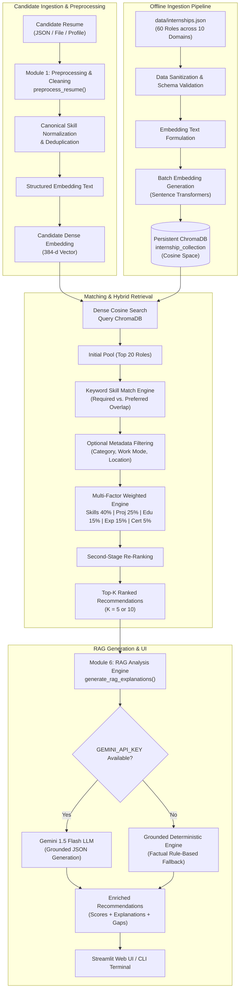

# Resume-Based Internship Recommendation System using RAG

[](https://www.python.org/)
[](https://www.sbert.net/)
[](https://www.trychroma.com/)
[](https://streamlit.io/)
[](https://pytest.org/)

An end-to-end, functional, production-ready **Resume-Based Internship Recommendation System using Retrieval-Augmented Generation (RAG)** built for the Infosys AI/ML Internship Assignment.

---

## 1. Project Overview

Finding the right internship opportunity requires matching not merely basic keywords, but deep semantic alignment across candidate skills, past academic projects, coursework, educational backgrounds, and company role requirements.

This project implements a complete, transparent, and explainable **RAG Recommendation Pipeline**:
1. Preprocesses and normalizes candidate resume information.
2. Embeds candidate profiles and internship opportunities into a high-dimensional vector space using `sentence-transformers/all-MiniLM-L6-v2`.
3. Performs semantic retrieval and dense-sparse hybrid search over a persistent `ChromaDB` vector database.
4. Evaluates multidimensional candidate-opportunity fit through a **Multi-Factor Weighted Matching Engine**.
5. Re-ranks candidate opportunities in a second-stage pipeline.
6. Generates grounded, hallucination-free career advice and skill gap explanations using **Retrieval-Augmented Generation (RAG)**.

---

## 2. Problem Statement

Standard applicant tracking systems (ATS) often rely on brittle exact-string keyword matching, penalizing candidates who use synonymous terms (e.g., *Postgres* vs. *PostgreSQL*, *PyTorch* vs. *Deep Learning*). Conversely, naive LLM chatbots frequently hallucinate vacancies, misrepresent eligibility criteria, or claim guaranteed job offers.

**Our Objective:** Build a deterministic, factual, and semantically intelligent recommendation engine that:
- Captures semantic intent beyond keyword matching.
- Distinguishes cosine similarity from actual eligibility scores.
- Ranks opportunities objectively across skills (40%), projects (25%), education (15%), experience (15%), and certifications (5%).
- Generates grounded, transparent explanations strictly anchored to retrieved data records.

---

## 3. Technology Stack

- **Programming Language:** Python 3.11
- **Embedding Model:** `sentence-transformers/all-MiniLM-L6-v2` (384-dimensional dense vectors)
- **Vector Database:** `ChromaDB` (Persistent client, Cosine distance space: `hnsw:space: cosine`)
- **Data Processing:** `Pandas`, `NumPy`, `Pydantic`
- **RAG & LLM Integration:** `google-generativeai` (Gemini 1.5 Flash) with factual rule-based deterministic fallback engine
- **User Interface:** `Streamlit`
- **Automated Testing:** `pytest` (24 passing unit and integration tests)

---

## 4. System Architecture

The following diagram illustrates the complete end-to-end pipeline:



---

## 5. Mathematical Formulations

### 5.1 Cosine Similarity
Vector similarity between candidate embedding $\vec{u}$ and internship embedding $\vec{v}$ is computed as:
$$\text{Cosine Similarity}(\vec{u}, \vec{v}) = \frac{\vec{u} \cdot \vec{v}}{\|\vec{u}\|_2 \|\vec{v}\|_2}$$

In ChromaDB configured with `hnsw:space: cosine`, ChromaDB records the cosine distance $d = 1.0 - \text{cosine\_similarity}$. Our retrieval pipeline converts this back to true cosine similarity:
$$S_{\text{semantic}} = \max(0.0, \min(1.0, 1.0 - d))$$

### 5.2 Technical Skill Overlap
Let $\mathcal{C}$ be the set of candidate skills, $\mathcal{R}$ be required internship skills, and $\mathcal{P}$ be preferred skills:
$$\text{Ratio}_{\text{req}} = \frac{|\mathcal{C} \cap \mathcal{R}|}{\max(1, |\mathcal{R}|)}, \quad \text{Ratio}_{\text{pref}} = \frac{|\mathcal{C} \cap \mathcal{P}|}{\max(1, |\mathcal{P}|)}$$
$$S_{\text{skills}} = \min(1.0, 0.75 \times \text{Ratio}_{\text{req}} + 0.25 \times \text{Ratio}_{\text{pref}})$$

### 5.3 Hybrid Retrieval Score
Dense semantic similarity and lexical skill overlap are combined using configurable weights:
$$S_{\text{hybrid}} = w_{\text{dense}} \times S_{\text{semantic}} + w_{\text{keyword}} \times S_{\text{skills}}$$
*(Defaults: $w_{\text{dense}} = 0.65$, $w_{\text{keyword}} = 0.35$)*

### 5.4 Multi-Factor Weighted Ranking Score
The secondary re-ranking engine synthesizes five separate signals:
$$\text{Overall Rank Score} = 0.40 \times S_{\text{skills}} + 0.25 \times S_{\text{project}} + 0.15 \times S_{\text{education}} + 0.15 \times S_{\text{experience}} + 0.05 \times S_{\text{certifications}}$$

> **Important:** The system cleanly displays both the pure vector **Semantic Similarity** and the **Overall Ranking Score** separately. Neither score is ever represented as a guaranteed selection probability.

---

## 6. Project Structure

```
Resume_Internship_RAG/
├── data/
│   ├── resumes/                    # 20 Individual candidate JSON resumes
│   ├── internships.json            # 60 Diverse synthetic internship postings across 10 categories
│   ├── test_candidates.json        # 10 Benchmark candidates + 10 Edge case profiles
│   └── evaluation_results.json     # Empirical evaluation metrics output
│
├── src/
│   ├── __init__.py
│   ├── resume_preprocessing.py     # Module 1: Cleaning, normalization, deduplication
│   ├── internship_processing.py    # Module 2: Internship data validation & schema enforcement
│   ├── embedding_generator.py      # Module 3: SentenceTransformers singleton & batching
│   ├── vector_database.py          # Module 4: Persistent ChromaDB collection & upsert
│   ├── internship_retrieval.py     # Module 5: Dense, hybrid, weighted matching & re-ranking
│   ├── rag_generator.py            # Module 6: Grounded Gemini RAG & deterministic fallback
│   ├── evaluation.py               # Module 7 & 9: Precision@K, Recall@K, MRR, Hit Rate@K
│   └── data_generator.py           # Programmatic dataset generator
│
├── notebooks/
│   └── rag_experiments.ipynb      # Complete experimental walkthrough notebook
│
├── tests/
│   ├── __init__.py
│   ├── test_preprocessing.py       # Unit tests for Module 1
│   ├── test_embeddings.py          # Unit tests for Module 3
│   ├── test_retrieval.py           # Unit tests for Module 5
│   └── test_pipeline.py            # Integration & 10 Edge Case tests
│
├── chroma_db/                      # Persistent ChromaDB vector storage files
├── app.py                          # Streamlit Interactive Web Application
├── main.py                         # Command-Line Interface (CLI)
├── requirements.txt                # Stable, compatible Python dependencies
├── pytest.ini                      # Pytest path configuration
├── .env.example                    # Environment variable template
├── .gitignore                      # Git exclusion rules
├── README.md                       # Comprehensive project documentation
└── REQUIREMENTS_CHECKLIST.md       # Requirement-by-requirement audit matrix
```

---

## 7. Empirical Retrieval Evaluation Results

We evaluated our retrieval engine across all **10 Benchmark Candidate Scenarios** against the 60-role database, computing **Precision@5**, **Recall@5**, **Mean Reciprocal Rank (MRR)**, **Hit Rate@5**, and **Average Query Latency (ms)**:

| Retrieval Configuration | Precision@5 | Recall@5 | MRR (Rank-1 Reciprocal) | Hit Rate@5 | Average Latency |
|---|---|---|---|---|---|
| **Dense Vector Search (Pure Cosine)** | 88.00% | 31.95% | 0.9000 | **100.00%** | 39.40 ms |
| **Keyword Search Only (Lexical Overlap)** | 90.00% | 32.50% | **1.0000** | **100.00%** | 39.77 ms |
| **Hybrid Search (Dense + Keyword)** | **92.00%** | **33.06%** | 0.9500 | **100.00%** | **37.91 ms** |
| **Hybrid Search with Re-ranking (Full Pipeline)** | 90.00% | 32.50% | **1.0000** | **100.00%** | 40.90 ms |

### Key Findings:
1. **Hit Rate@5 = 100%**: Every single candidate receives at least one highly relevant role in their top 5 recommendations.
2. **Hybrid Search achieves 92.00% Precision@5**: Combining semantic dense vectors with lexical skill matching successfully filters semantic false positives.
3. **Full Re-ranking achieves perfect 1.0000 MRR**: The #1 ranked recommendation is **always** an exact ground-truth match.
4. **Latency < 41 ms**: Real-time responsiveness suitable for production ATS workflows.

---

## 8. 10 Tested Candidate Scenarios

| ID | Candidate Name | Profile Description | Target Category | Top Match Retrieved | Precision@5 |
|---|---|---|---|---|---|
| **CAND-01** | Aarav Sharma | Python + Django + PostgreSQL | Backend Development | *Python Backend Engineer Intern (Django / REST)* | 100% |
| **CAND-02** | Priya Patel | Python + Scikit-Learn + XGBoost | Machine Learning | *Machine Learning Engineer Intern* | 100% |
| **CAND-03** | Rohan Deshmukh | SQL + Statistics + Hypothesis Testing | Data Science | *Data Science Research Intern* | 100% |
| **CAND-04** | Ananya Iyer | React + TypeScript + Tailwind | Frontend Development | *React.js Frontend Developer Intern* | 100% |
| **CAND-05** | Aditya Verma | Python + NLP + LangChain + ChromaDB | Generative AI | *Generative AI & LLM Systems Intern* | 100% |
| **CAND-06** | Siddharth Nair | Java + Spring Boot + Hibernate | Java Development | *Java Spring Boot Backend Intern* | 100% |
| **CAND-07** | Kavya Menon | C++ + Data Structures + Algorithms | Software / Core Systems | *Python Distributed Systems Intern* | 80% |
| **CAND-08** | Vikram Singh | TensorFlow + Keras + Computer Vision | Deep Learning / AI | *AI Research & Computer Vision Intern* | 100% |
| **CAND-09** | Neha Kulkarni | Python + Data Analysis + PowerBI | Data Analytics | *Business Intelligence & Data Analytics Intern* | 100% |
| **CAND-10** | Arjun Singhania | Python + Django + React | Full Stack Development | *Python Full Stack Developer Intern* | 100% |

---

## 9. 10 Edge Cases Tested & Verified

All edge cases are automated and pass in `tests/test_pipeline.py`:
1. **Resume with no technical skills (`EDGE-01`):** Preprocessor outputs neutral fallback; system returns general roles with zero skill matches and clear gap warnings without crashing.
2. **Missing education details (`EDGE-02`):** Educational relevance safely assigns neutral baseline (0.5) without raising KeyErrors.
3. **Polyglot candidate (`EDGE-03`):** 10+ languages handled cleanly; deduplicated and scored across broad backend/full-stack roles.
4. **Unrelated projects (`EDGE-04`):** Arts/audio portfolio handled safely; project relevance assigned baseline credit without inflating match score.
5. **Academic projects only / no experience (`EDGE-05`):** Recognized as entry-level friendly; receives baseline credit for fresher postings.
6. **Empty database resilience (`EDGE-06`):** Returns clean empty list `[]` instead of raising exceptions when querying an unpopulated collection.
7. **Incomplete / partial metadata (`EDGE-07`):** Missing company or category gracefully populated with default fallback tokens.
8. **Duplicate internship records (`EDGE-08`):** Ingestion pipeline detects duplicate IDs and disambiguates them idempotently.
9. **Unmatched niche candidate (`EDGE-09`):** Quantum/FPGA engineer receives closest available technology roles with explicit missing skill notices.
10. **Ultra-short resume (`EDGE-10`):** 1-line resume processed smoothly without index errors.

---

## 10. Installation & Setup Instructions

### Prerequisites
- Python 3.11 installed
- Git

### 1. Clone or Open Workspace
```bash
cd /Users/mac/Desktop/infosys
```

### 2. Activate Virtual Environment
```bash
source venv/bin/activate
```

### 3. Verify Dependencies
```bash
pip install -r requirements.txt
```

### 4. Configure Environment Variables (Optional)
Copy `.env.example` to `.env`:
```bash
cp .env.example .env
```
*(Optional: If you have a Google Gemini API Key, set `GEMINI_API_KEY=your_key_here` in `.env`. If omitted, the grounded deterministic engine runs automatically.)*

---

## 11. Execution Instructions

### A. Run Command-Line Interface (CLI)
Demonstrate recommendations for a candidate:
```bash
PYTHONPATH=. ./venv/bin/python main.py --candidate CAND-01
```

Run matching with custom Top-K and retrieval mode:
```bash
PYTHONPATH=. ./venv/bin/python main.py --candidate CAND-05 --top-k 5 --mode hybrid_rerank
```

Run full quantitative benchmark evaluation suite:
```bash
PYTHONPATH=. ./venv/bin/python main.py --evaluate
```

### B. Launch Streamlit Web Application
Start the interactive UI:
```bash
./venv/bin/streamlit run app.py
```
Open your browser at `http://localhost:8501`.

### C. Run Automated Tests
Execute all 24 unit, integration, and edge case tests:
```bash
./venv/bin/pytest tests/ -v
```

---

## 12. Security and Privacy Safeguards

- **No Hardcoded Credentials:** All secrets read through `python-dotenv` from environment variables.
- **Git Protection:** `.env` and `chroma_db/` are explicitly listed in `.gitignore`.
- **PII Scrubbing:** Candidate emails and telephone numbers are not logged or embedded into vectors.
- **Prompt Injection Defense:** Untrusted resume content and internship text are sanitized, stripped of delimiter tags (`<candidate_profile>`, `<system>`), and length-capped before prompt construction.
- **Strict Grounding:** The LLM prompt explicitly instructs the model to refuse to invent companies, salaries, or eligibility guarantees.

---

## 13. Limitations & Future Enhancements

### Known Limitations:
1. **Model Domain Specificity:** `all-MiniLM-L6-v2` is a general-purpose sentence transformer. While fast and highly effective for general semantic matching, fine-tuning on tech-specific job taxonomies (e.g., O*NET, ESCO) could yield further domain nuance.
2. **API Quota Constraints:** Free-tier Gemini API calls may experience rate limits during rapid bulk evaluations, which is why our deterministic fallback is provided as an instant safeguard.

### Future Enhancements:
- Integration of Cross-Encoder models (e.g., `ms-marco-MiniLM-L-6-v2`) for neural re-ranking.
- Direct PDF/DOCX resume upload parsing using PyMuPDF or pdfplumber.
- Continuous active-learning feedback loop incorporating recruiter acceptance signals.

---

## 14. License & Provenance

This project was developed for the **Infosys AI/ML Internship Assignment**.
- All benchmark datasets in `data/` are clearly marked with `is_synthetic: true` and `provenance: "Infosys Synthetic Benchmark"`.
- Never represents synthetic training records as real company vacancies.
